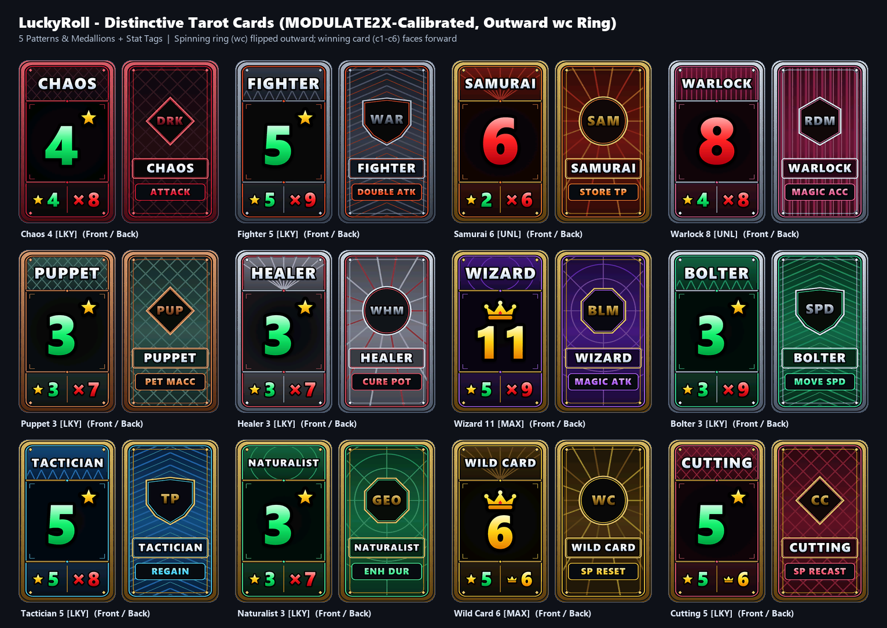

# LuckyRoll

High-contrast **256×256 DXT3 Arabic Corsair roll numbers** (`512×256` `BUST!`) paired with **33 distinctive, MODULATE2X-calibrated `256×512` Tarot Cards** built cleanly on retail Final Fantasy XI DATs for **Windower XIPivot**.

No more squinting at spinning Roman numerals or guessing whether a flash in Sortie was a `IV`, `V`, `VI`, `IX`, or `XI`.


<table>
  <tr>
    <td align="center">
      <br/>
      <sub><b>Lucky <code>2 ★</code></b> — Vivid emerald numeral + gold star badge</sub>
    </td>
    <td align="center">
      <br/>
      <sub><b>Unlucky <code>9</code></b> — Bold crimson numeral with thick black outline</sub>
    </td>
  </tr>
</table>

---

## Choose Your Version (2 Included Packs)

Both ready-to-drop XIPivot packs share the exact same HD numerals, 33 custom Tarot Cards, and texture namespace isolation — the only difference is animation timing:

| Pack Folder | Timing Style | Best For |
|---|---|---|
| **`LuckyRoll/`** | **Standard (Stock Retail Timing)** | Players using DressUp blink prevention (`//du blinking all always on`) or wanting the original retail suspense (cards spin → winning card pops → total number appears at `3.23s`). |
| **`LuckyRoll_BlinkSafe/`** | **Blink-Safe Fast Reveal** *(Recommended for viewing blinking CORs)* | Sped up for viewing Corsairs who swap weapons (`Sword ↔ Rostam`, ranged swaps) without blink protection. Launches **both the spinning cards and the big total number at Frame 0 (`0.00s`)**, extends the card ring (`1.00s → 1.83s`), widens the popped card hold (`0.31s → 1.21s`), and holds the roll total (`1.47s → 2.50s`) plus Wild Card / Cutting Cards (`1.07s → 2.00s`) so you clearly see the number and cards *before* their aftercast weapon-swap blink cuts off the animation — with **zero** extra character animation lock. |

> **Why two packs?** On retail FFXI, the floating total number doesn't spawn until **`3.23s`**. If a COR swaps weapons in GearSwap `aftercast`, that blink cancels the animation around `1–2s` — meaning observers on stock timing often see nothing at all. `LuckyRoll_BlinkSafe/` beats that blink by moving cards & numbers to Frame 0. *(Note: if a COR blinks on **precast** the exact frame the roll fires, FFXI skips starting the animation altogether — pair with `//du blinking all always on` in DressUp if needed.)*

---

## Features

- **Ultra-Readable Arabic Numerals (`256×256` DXT3 + `512×256` `BUST!`)**: Heavy sans-serif glyphs (`1`–`11` & `BUST!`) with outward Euclidean distance-transform pitch-black outlines and drop shadows so numbers pop cleanly against both dark Sortie arenas and bright snow zones.
- **Per-Roll Lucky / Unlucky Color Coding & Badges**:
  - **White**: Standard roll (`1`–`10`)
  - **Emerald Green + Gold Star (`★`)**: Roll-specific **Lucky** number (`2`, `3`, `4`, or `5`)
  - **Crimson Red (`×`)**: Roll-specific **Unlucky** number (`6`, `7`, `8`, `9`, or `10`)
  - **Radiant Gold + Royal Crown**: **11** (Jackpot), Wild Card `6`, and Cutting Cards `6`
  - **Gold-White + Star**: **Snake Eye** (`1`)
  - **Crimson `BUST!` Banner**: Wide `512×256` Bust indicator
- **33 Distinct Per-Roll Tarot Cards (`256×512` DXT3)**:
  - **Front (`d0`)**: Per-roll metallic border (`gold`, `silver`, `steel`, `copper`, `crimson`), top roll name banner (`SAMURAI`, `CHAOS`, `FIGHTER`, `BOLTER`, etc.), dark velvet center window behind the floating number, and a **Lucky / Unlucky cheat-sheet footer** (`★ Lucky | × Unlucky`).
  - **Back (`c0`)**: Five distinct tarot patterns & medallions (Sunburst Circle, Chevrons Shield, Arcane Rings Octagon, Stripes Hexagon, Lattice Diamond), job/roll crest (`WAR`, `SAM`, `DRK`, `SPD`, etc.), name ribbon, and **stat tag pill** (`DOUBLE ATK`, `STORE TP`, `ATTACK`, `MOVE SPD`, etc.).
- **Outward-Facing Spinning Ring (`wc`) + Forward Winning Card (`c1`–`c6`)**: The 6-card orbiting ring (`wc`) is re-oriented outward with corrected normals, un-mirrored full-card UVs, and aspect compensation so roll names, numbers (`1`–`6`), and Lucky/Unlucky cheat sheets face the camera while spinning, while the winning popped card (`c1`–`c6`) continues facing forward.
- **Full Texture Namespace Isolation (`cor_r01_`–`cor_r31_`)**: Retail Phantom Roll DATs all share colliding `cor_cd01*` internal texture names in FFXI's global texture cache. LuckyRoll isolates every Phantom Roll with unique internal prefixes so Busts, rapid rolls, or nearby Corsairs / Qultada never bleed cached textures across rolls.
- **All 44 Corsair Ability DATs Included**:
  - **31 Phantom Rolls** (`ROM/162`–`ROM/321`)
  - **6 Wild Card DATs** (`ROM/165/17.DAT`–`22.DAT`) — `1–4` White, `5 ★` Lucky, `6` Gold Crown (`WC` / `SP RESET`)
  - **6 Cutting Cards DATs** (`ROM/306/122.DAT`–`127.DAT`) — `1–4` White, `5 ★` Lucky, `6` Gold Crown (`CC` / `SP RECAST`)
  - **1 Snake Eye DAT** (`ROM/184/80.DAT`) — Gold-White `1 ★`

---

## Previews

### Custom Tarot Cards (Front & Back)


### Post-DXT3 Numerals & Badges


---

## Installation (Windower 4 + XIPivot)

1. Download this repository (or clone it / grab the release zip) and pick **one** folder — **`LuckyRoll`** (Standard) or **`LuckyRoll_BlinkSafe`** (Blink-Safe Fast Reveal) — and place it inside your Windower XIPivot `DATs` directory:
   ```text
   Windower4/addons/XIPivot/data/DATs/LuckyRoll/
   ```
   *or*
   ```text
   Windower4/addons/XIPivot/data/DATs/LuckyRoll_BlinkSafe/
   ```
   Confirm the `ROM/` directory sits directly underneath your chosen pack folder.
2. Add your chosen pack **first** in `<overlays>` in `Windower4/addons/XIPivot/data/settings.xml` (ahead of global HD packs such as `NextHD` so LuckyRoll overrides their roll DATs cleanly):
   ```xml
   <overlays>LuckyRoll_BlinkSafe,NextHD,...</overlays>
   ```
3. In-game, reload XIPivot (`//lua reload xipivot`) and zone or relog to clear any previously cached effect DATs.
4. *(Optional)* To also stop COR **precast** weapon-swap blinks completely on your screen, enable DressUp blink prevention: `//du blinking all always on`.

---

## Included DAT Reference (44 DATs)

<details>
<summary>Expand full table of all 31 Phantom Rolls + Wild Card, Cutting Cards & Snake Eye</summary>

| # | Roll / Ability | Lucky | Unlucky | Crest | Stat Tag | DAT Path |
|---:|---|---:|---:|---|---|---|
| 1 | Fighter's Roll | 5 | 9 | `WAR` | `DOUBLE ATK` | `ROM/163/90.DAT` |
| 2 | Monk's Roll | 3 | 7 | `MNK` | `SUBTLE BLOW` | `ROM/162/50.DAT` |
| 3 | Healer's Roll | 3 | 7 | `WHM` | `CURE POT` | `ROM/164/45.DAT` |
| 4 | Wizard's Roll | 5 | 9 | `BLM` | `MAGIC ATK` | `ROM/164/46.DAT` |
| 5 | Warlock's Roll | 4 | 8 | `RDM` | `MAGIC ACC` | `ROM/164/47.DAT` |
| 6 | Rogue's Roll | 5 | 9 | `THF` | `CRIT RATE` | `ROM/164/48.DAT` |
| 7 | Gallant's Roll | 3 | 7 | `PLD` | `DEFENSE` | `ROM/164/49.DAT` |
| 8 | Chaos Roll | 4 | 8 | `DRK` | `ATTACK` | `ROM/164/50.DAT` |
| 9 | Beast Roll | 4 | 8 | `BST` | `PET ATK` | `ROM/164/51.DAT` |
| 10 | Choral Roll | 2 | 6 | `BRD` | `SPELL INT` | `ROM/164/52.DAT` |
| 11 | Hunter's Roll | 4 | 8 | `RNG` | `ACCURACY` | `ROM/164/53.DAT` |
| 12 | Samurai Roll | 2 | 6 | `SAM` | `STORE TP` | `ROM/164/54.DAT` |
| 13 | Ninja Roll | 4 | 8 | `NIN` | `EVASION` | `ROM/164/55.DAT` |
| 14 | Drachen Roll | 4 | 8 | `DRG` | `PET ACC` | `ROM/164/56.DAT` |
| 15 | Evoker's Roll | 5 | 9 | `SMN` | `REFRESH` | `ROM/164/57.DAT` |
| 16 | Magus's Roll | 2 | 6 | `BLU` | `MAGIC DEF` | `ROM/164/58.DAT` |
| 17 | Corsair's Roll | 5 | 9 | `COR` | `EXP / CP` | `ROM/164/59.DAT` |
| 18 | Puppet Roll | 3 | 7 | `PUP` | `PET MACC` | `ROM/164/60.DAT` |
| 19 | Dancer's Roll | 3 | 7 | `DNC` | `REGEN` | `ROM/164/61.DAT` |
| 20 | Scholar's Roll | 2 | 6 | `SCH` | `CONS MP` | `ROM/198/107.DAT` |
| 21 | Bolter's Roll | 3 | 9 | `SPD` | `MOVE SPD` | `ROM/246/101.DAT` |
| 22 | Caster's Roll | 2 | 7 | `FC` | `FAST CAST` | `ROM/246/102.DAT` |
| 23 | Courser's Roll | 3 | 9 | `SNP` | `SNAPSHOT` | `ROM/256/87.DAT` |
| 24 | Blitzer's Roll | 4 | 9 | `HST` | `HASTE` | `ROM/256/88.DAT` |
| 25 | Tactician's Roll | 5 | 8 | `TP` | `REGAIN` | `ROM/261/40.DAT` |
| 26 | Allies' Roll | 3 | 10 | `SC` | `SC DMG` | `ROM/262/28.DAT` |
| 27 | Miser's Roll | 5 | 7 | `STP` | `SAVE TP` | `ROM/265/25.DAT` |
| 28 | Companion's Roll | 2 | 10 | `PET` | `PET REGEN` | `ROM/265/32.DAT` |
| 29 | Avenger's Roll | 4 | 8 | `CTR` | `COUNTER` | `ROM/265/33.DAT` |
| 30 | Naturalist's Roll | 3 | 7 | `GEO` | `ENH DUR` | `ROM/321/72.DAT` |
| 31 | Runeist's Roll | 4 | 8 | `RUN` | `MAGIC EVA` | `ROM/321/73.DAT` |
| 32–37 | Wild Card (6 DATs) | 5 | 6 (`MAX`) | `WC` | `SP RESET` | `ROM/165/17.DAT` – `22.DAT` |
| 38–43 | Cutting Cards (6 DATs) | 5 | 6 (`MAX`) | `CC` | `SP RECAST` | `ROM/306/122.DAT` – `127.DAT` |
| 44 | Snake Eye | 1 (`★`) | — | — | — | `ROM/184/80.DAT` |

</details>

---

## Optional: Customizing & Rebuilding from Retail DATs

You do **not** need Python or this script to use LuckyRoll — both `LuckyRoll/` and `LuckyRoll_BlinkSafe/` work out of the box.

The generator at [`tools/build_luckyroll.py`](tools/build_luckyroll.py) is included for players and modders who want to:
- Customize number or card colors (for example, **colorblind-friendly palettes**) by editing `PALETTES` / `CARD_THEMES`.
- Swap typography via `--font <path-to-ttf>`.
- Rebuild either **Standard** or **Blink-Safe** DATs against a retail FFXI install or future FFXI client patch.
- Audit every patched section, DXT3 texture, card mesh, texture namespace, and timing curve (`--verify` / `--verify --blink-safe`).

**Requirements**: Python 3.9+, `pillow`, `numpy`, and a clean retail FFXI installation containing `ROM/`.

```powershell
# Rebuild Standard LuckyRoll/ (44 DATs + preview sheets)
python tools/build_luckyroll.py

# Rebuild Blink-Safe LuckyRoll_BlinkSafe/ (Frame-0 cards & number + extended visibility)
python tools/build_luckyroll.py --blink-safe

# Verify existing builds against retail DATs
python tools/build_luckyroll.py --verify
python tools/build_luckyroll.py --verify --blink-safe

# Custom FFXI path + export a clean XIPivot zip
python tools/build_luckyroll.py --blink-safe --ffxi-root "D:\Games\FINAL FANTASY XI" --zip LuckyRoll_BlinkSafe_XIPivot.zip
```

---

## Known Retail FFXI Behavior

- **Bust (`12+`) Card Quirk**: Square Enix's server hardcodes animation ID `98` (`ROM/163/90.DAT`, Fighter's Roll) whenever *any* Phantom Roll Busts (`12+`), so you will briefly see the `FIGHTER` card right before the `BUST!` popup regardless of which roll was active. Because LuckyRoll isolates every roll's internal texture namespace (`cor_r01_`–`cor_r31_`), that Fighter's Bust animation will never corrupt your actual active roll textures afterward.
